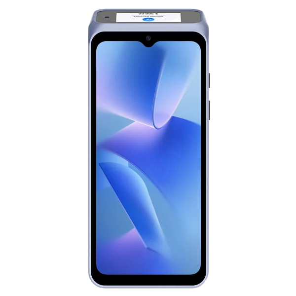
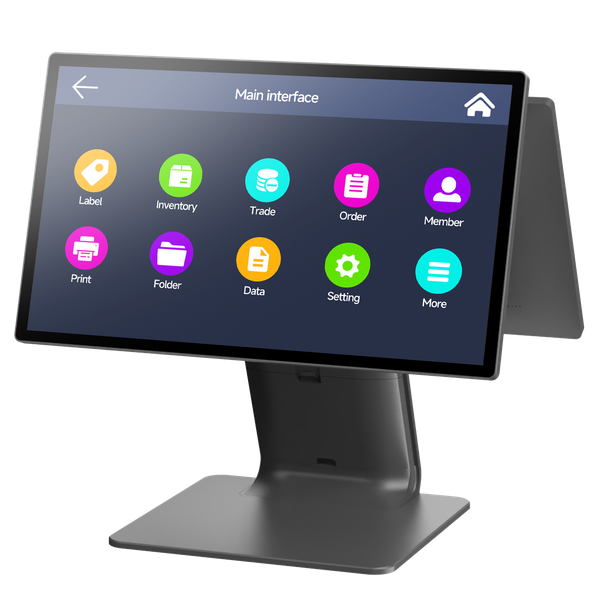
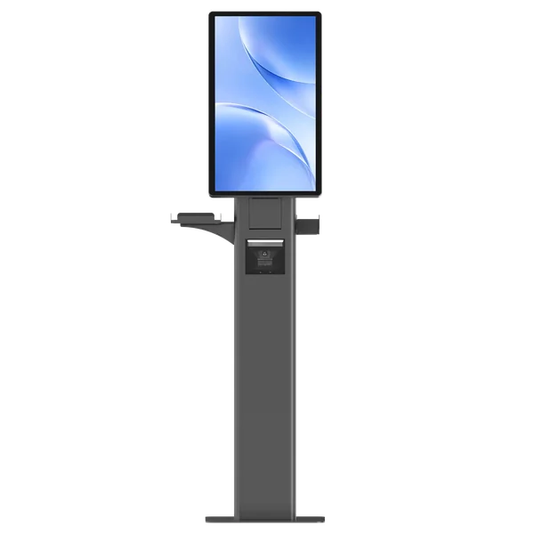
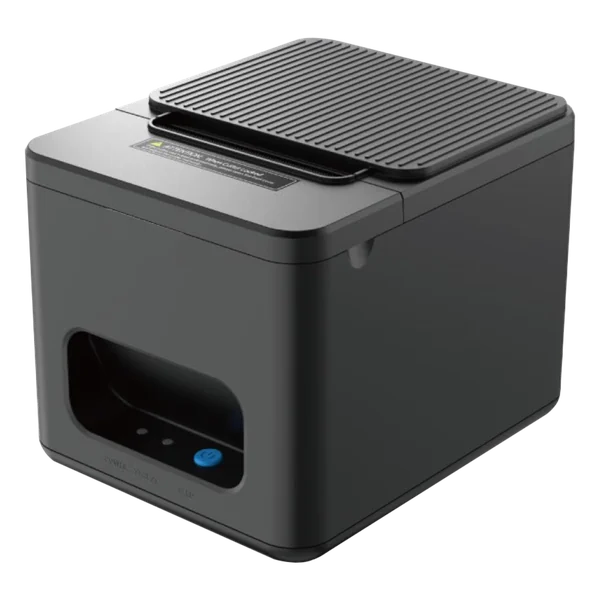
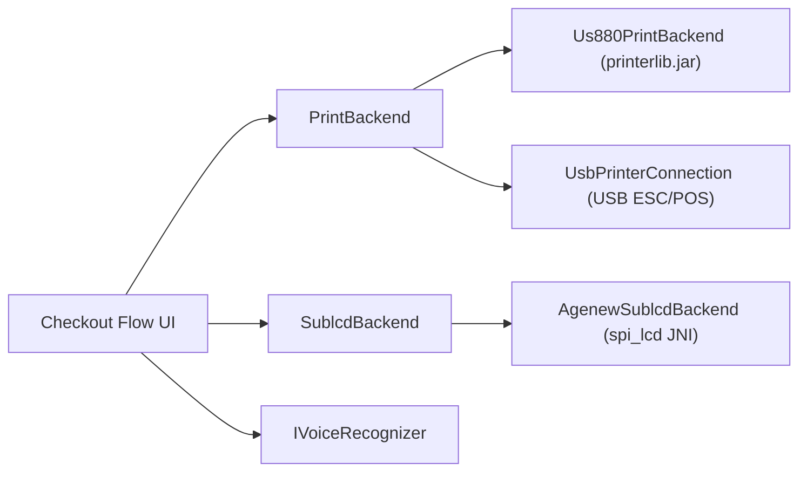

<div align="center">
  <a href="https://www.suntekai.com">
    <picture>
      <source media="(prefers-color-scheme: dark)" srcset="https://raw.githubusercontent.com/SUNTEK-Official/.github/main/profile/assets/logo-dark.png">
      <source media="(prefers-color-scheme: light)" srcset="https://raw.githubusercontent.com/SUNTEK-Official/.github/main/profile/assets/logo-light.png">
      
    </picture>
  </a>

  <h1>SUNTEK Multi-Model POS &amp; Kiosk Checkout Demo</h1>

  <p>
    <strong>Reference Retail &amp; Self-Service Checkout Application</strong> &middot; <em>Enjoy Smarter Service</em><br>
    Open-source Apache-2.0 multi-flavor Android &amp; Desktop Qt checkout demo by <strong>SUNTEK Technology Co., Ltd.</strong>
  </p>

  <p>
    <a href="./LICENSE"></a>
    <a href="https://github.com/SUNTEK-Official/suntek-demo-pos-checkout/releases"></a>
    
    <a href="https://www.suntekai.com"></a>
  </p>

    <p>
      <a href="#supported-hardware-showcase">Hardware Targets</a> &nbsp;&bull;&nbsp;
      <a href="#backend-abstraction-architecture">Architecture</a> &nbsp;&bull;&nbsp;
      <a href="#android-checkout-application-android">Android App</a> &nbsp;&bull;&nbsp;
      <a href="#desktop-qt-c-demo-windows">Desktop Qt Demo</a> &nbsp;&bull;&nbsp;
      <a href="#architecture--licensing-notice">Licensing</a>
    </p>

  
</div>

---

## Supported Hardware Showcase

<table>
  <tr>
    <td align="center" width="25%">
      <a href="../suntek-sdk-sm6"></a><br>
      <strong>SM6 Smart POS</strong><br>
      <sub>Built-in Thermal Printer &amp; SPI Sub-LCD</sub>
    </td>
    <td align="center" width="25%">
      <a href="../suntek-sdk-sc1-sk1"></a><br>
      <strong>SC1 Desktop POS</strong><br>
      <sub>USB Host ESC/POS Helper</sub>
    </td>
    <td align="center" width="25%">
      <a href="../suntek-sdk-sk7"></a><br>
      <strong>SK7 Kiosk</strong><br>
      <sub>USB ESC/POS &amp; Voice Interface</sub>
    </td>
    <td align="center" width="25%">
      <a href="../suntek-sdk-printer-scp80"></a><br>
      <strong>SCP80 Printer</strong><br>
      <sub>Windows Qt C++ &amp; POS_SDK.dll</sub>
    </td>
  </tr>
</table>

---

## Backend Abstraction Architecture

Complete Android &amp; Windows Qt retail checkout reference application built around hardware abstraction interfaces (`com.suntek.checkoutapplication` in `android/` and `POSDllLoader` / `PrinterManager` in `windows/`):

- `PrintBackend` / `Us880PrintBackend` / `Us880Printer` — Thermal receipt &amp; QR code printing via `printerlib.jar` (`com.pos.devices.Printer`) + `libprinter_dll.so`
- `SublcdBackend` / `AgenewSublcdBackend` / `Us880CustomerDisplay` — Secondary SPI LCD customer display rendering via JNI (`spi_lcd.c`)
- `UsbPrinterConnection` — Android USB Host bulk-transfer ESC/POS transport for external USB receipt printers
- `IVoiceRecognizer` — Pluggable BCP-47 speech recognition contract (bring your own Android `SpeechRecognizer` or Vosk engine; zero hardcoded cloud API keys)



---

## Android Checkout Application (`android/`)

1. Open `android/` in Android Studio (`targetSdk 36`, `minSdk 30`, NDK `27.0.12077973` for `spi_lcd.c`).
2. `android/app/libs/printerlib.jar` and `android/app/src/main/jniLibs/{arm64-v8a,armeabi-v7a}/libprinter_dll.so` are bundled directly for out-of-the-box hardware testing:
   ```bash
   cd android && ./gradlew assembleDebug
   ```

---

## Desktop Qt C++ Demo (`windows/`)

Complete Qt 6 QML point-of-sale checkout UI (`CMakeLists.txt`, `Cashier.qml`, `ESPOSPrint.qml`, `TSPLPrint.qml`, `CPCLPrint.qml`, `PrinterManager`) loading `windows/POS_SDK.dll` via `POSDllLoader`.

---

## Architecture & Licensing Notice

- **Framework-Native UI & ZXing QR Generation**: Uses AndroidX + `com.google.zxing:core:3.5.3` (Apache-2.0) and native C JNI `spi_lcd.c` with zero copyleft native dependencies.
- **No Hardcoded Cloud Secrets**: `IVoiceRecognizer` ships as a clean backend interface without embedded third-party speech API keys.
- Repository source code is licensed under [Apache-2.0](./LICENSE); see [`THIRD_PARTY_NOTICES.md`](./THIRD_PARTY_NOTICES.md) for component notices.

---

<div align="center">
  
  <br><br>
  <strong>SUNTEK Technology Co., Ltd.</strong> &mdash; <em>Smart Commercial Terminal Hardware Manufacturer Since 2010</em><br>
  <sub>80+ Export Countries &middot; 5,000,000+ Terminals Shipped &middot; ISO 9001 / ISO 27001 / CE / RoHS</sub><br>
  <sub><a href="https://www.suntekai.com">www.suntekai.com</a> &middot; Copyright &copy; 2026 SUNTEK Technology Co., Ltd. All rights reserved.</sub>
</div>
